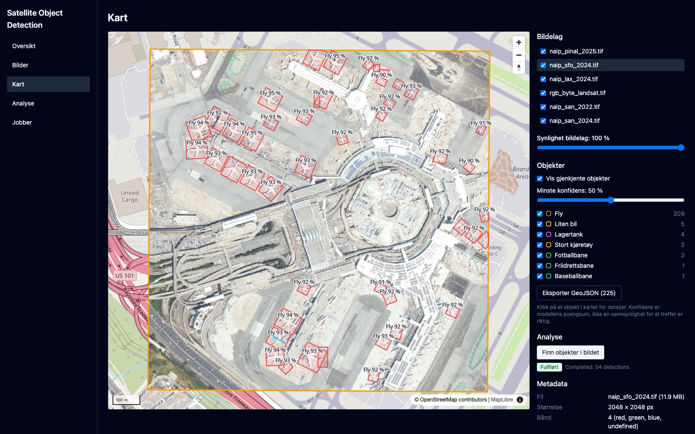
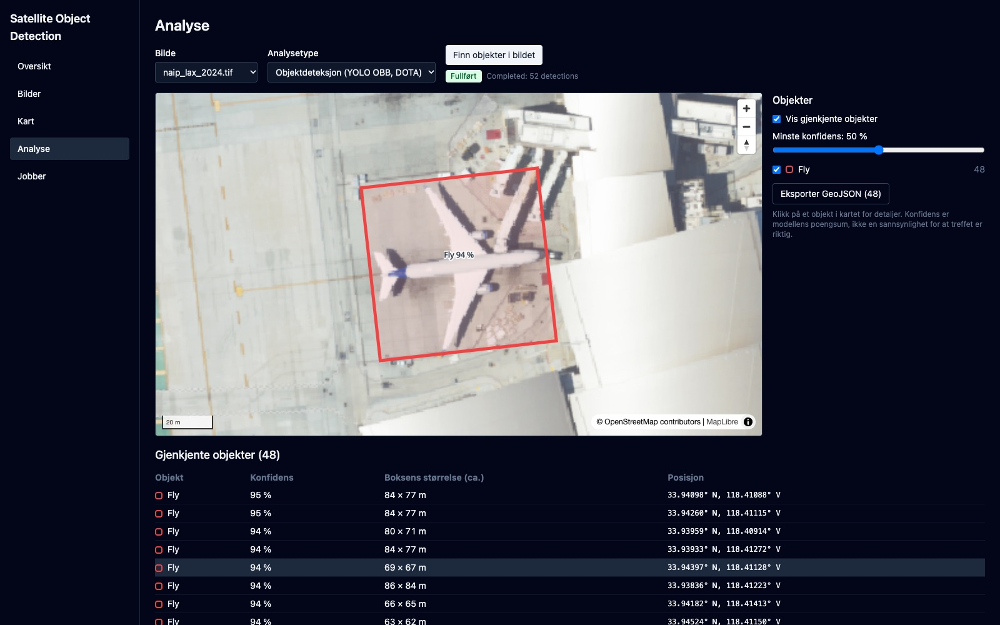
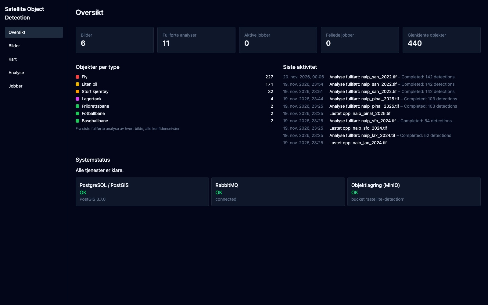

# Satellite Object Detection

Satellite Object Detection is a full-stack geospatial application for uploading georeferenced imagery, viewing it on
an interactive map, and finding objects such as aircraft, ships, vehicles and storage tanks with a
computer-vision model. Detections are stored as geographic polygons in PostGIS and can be filtered,
inspected and exported as GeoJSON.



*NAIP aerial imagery (0.6 m, USDA, public domain) of San Francisco International Airport over an
OpenStreetMap basemap. Each outline is a detection from the pretrained YOLO26-s OBB model.*

## Features

- **Upload GeoTIFFs**, validated as untrusted input. Metadata is extracted, and the original and a
  Cloud Optimized GeoTIFF are stored in S3-compatible object storage (MinIO).
- **View imagery on a map** (MapLibre). Map tiles are read directly from the COG and reprojected to
  Web Mercator.
- **Detect objects** with a pretrained oriented-bounding-box YOLO model (DOTA v1 classes). Large
  images are processed in overlapping tiles, duplicates are merged, and boxes are converted to
  geographic polygons.
- **Run analyses as background jobs** (RabbitMQ + Celery) with real progress, retries for transient
  errors and a dead-letter queue.
- **Explore results** with class filters, confidence filters, an object table that zooms the map to
  each object, a job monitor, a dashboard and GeoJSON export.

| Analysis page | Dashboard |
|---|---|
|  |  |

## Architecture

```text
Browser (React, MapLibre)
        │  REST (JSON, GeoJSON, PNG tiles)
        ▼
FastAPI ──────────────► PostgreSQL + PostGIS   images, jobs, detections (EPSG:4326)
   │   │
   │   └──────────────► MinIO (S3 API)         original GeoTIFF, COG, preview
   │                         ▲
   │ job id only             │ read COG
   ▼                         │
RabbitMQ ──► Celery worker(s): tiling → YOLO OBB → merge → pixel→geo → PostGIS
```

The API does not process imagery for analysis; workers do, and queue messages carry only a job id.
Details: [docs/architecture.md](docs/architecture.md).

| Area | Technology |
|---|---|
| Frontend | React, TypeScript, Vite, Tailwind CSS, MapLibre GL JS, TanStack Query, Zustand |
| Backend | Python 3.12, FastAPI, SQLAlchemy 2 (async), Alembic, GeoAlchemy2 |
| Data and jobs | PostgreSQL 17 + PostGIS, MinIO, RabbitMQ, Celery |
| Geospatial | GDAL (via Rasterio), rio-tiler, PyProj, Shapely |
| Computer vision | PyTorch, Ultralytics YOLO26-s OBB, OpenCV |

## Quick start (macOS)

Requires [Homebrew](https://brew.sh). Everything runs natively; Docker is not used. The repository
is private, so you need to have been given access to clone it.

**1. Install and set up (once).** Run the database block in a single terminal window, because
the generated password is reused across its lines.

```bash
brew install git node python@3.12 postgresql@17 postgis rabbitmq minio
brew link --force postgresql@17   # postgresql@17 is keg-only: puts psql and createdb on PATH
brew services start postgresql@17 && brew services start rabbitmq

git clone https://github.com/vaithekym/satellite-object-detection.git
cd satellite-object-detection
$(brew --prefix)/bin/python3.12 -m venv .venv
.venv/bin/pip install -e "backend[dev]"
(cd frontend && npm install)

# Configuration with random passwords, and the database
cp .env.example .env && chmod 600 .env
DBPW=$(openssl rand -hex 16); S3PW=$(openssl rand -hex 16)
sed -i '' -e "s|satellite_detection:change-me@|satellite_detection:$DBPW@|g" \
          -e "s|^S3_SECRET_KEY=.*|S3_SECRET_KEY=$S3PW|" .env
psql -d postgres -c "CREATE ROLE satellite_detection LOGIN PASSWORD '$DBPW';"
createdb --owner satellite_detection satellite_detection
createdb --owner satellite_detection satellite_detection_test   # for the integration tests
psql -d satellite_detection -c "CREATE EXTENSION postgis;"
psql -d satellite_detection_test -c "CREATE EXTENSION postgis;"
make migrate
make model      # detector weights (checksum-verified)
```

**2. Start the services**, each in its own terminal:

```bash
make minio      # object storage
make backend    # API on http://127.0.0.1:8000 (docs at /docs)
make worker     # analysis jobs
make frontend   # UI on http://localhost:5173
```

**3. Load the demo data (once).** With the services running:

```bash
make init-storage   # create the storage bucket
make demo           # download the sample images, upload them and analyse them (about 1 minute)
```

Homebrew's MinIO formula is deprecated and will be disabled on 2027-02-17. After that, use any
S3-compatible store (for example `brew install seaweedfs`) and set `S3_ENDPOINT_URL` in `.env`.

`make demo` gives every machine the same six images and the same detections (440 objects). Open
<http://localhost:5173>. You can also upload your own GeoTIFFs on **Bilder** and analyse them on
**Analyse**. Configuration and troubleshooting are covered in [docs/development.md](docs/development.md).

## Linux and Windows

> Only macOS has been tested. These instructions should work, but they have not been verified.

### Linux (Ubuntu 24.04 / Debian)

Install the system packages. Ubuntu 24.04 ships PostgreSQL 16, which works as well as 17.

```bash
sudo apt update
sudo apt install -y git make python3.12 python3.12-venv postgresql postgis rabbitmq-server
sudo systemctl enable --now postgresql rabbitmq-server

# Node.js 24 (the apt version is too old), via nvm:
curl -o- https://raw.githubusercontent.com/nvm-sh/nvm/v0.40.3/install.sh | bash
source ~/.bashrc && nvm install 24
```

MinIO is not available through apt and no longer publishes prebuilt binaries. Choose one:

- Build it with Go: `go install github.com/minio/minio@latest` (requires a recent Go), then add
  `~/go/bin` to `PATH` so that `make minio` finds it.
- Use another S3-compatible store, such as SeaweedFS or Garage, and set `S3_ENDPOINT_URL` in
  `.env` (then `make minio` is not used).
- If Docker is acceptable on that machine, run this from the project folder after `.env` exists:

  ```bash
  set -a && . ./.env && set +a
  docker run -d -p 127.0.0.1:9000:9000 -e MINIO_ROOT_USER="$S3_ACCESS_KEY" \
    -e MINIO_ROOT_PASSWORD="$S3_SECRET_KEY" minio/minio server /data
  ```

Then follow the macOS quick start from `git clone` onwards, with these differences:

```bash
python3.12 -m venv .venv          # instead of $(brew --prefix)/bin/python3.12

# sed -i without '' on Linux
sed -i -e "s|satellite_detection:change-me@|satellite_detection:$DBPW@|g" \
       -e "s|^S3_SECRET_KEY=.*|S3_SECRET_KEY=$S3PW|" .env

# The PostgreSQL superuser is "postgres" on Linux, so prefix the database commands with sudo -u postgres:
sudo -u postgres psql -c "CREATE ROLE satellite_detection LOGIN PASSWORD '$DBPW';"
sudo -u postgres createdb --owner satellite_detection satellite_detection
sudo -u postgres createdb --owner satellite_detection satellite_detection_test
sudo -u postgres psql -d satellite_detection -c "CREATE EXTENSION postgis;"
sudo -u postgres psql -d satellite_detection_test -c "CREATE EXTENSION postgis;"
```

Steps 2 and 3 (`make minio`, `make backend`, `make worker`, `make frontend`, `make init-storage`,
`make demo`) are the same.

### Windows

The project is not supported directly on Windows: the Makefile and shell commands need a Unix
environment, and Celery's default worker pool does not run on Windows. Use WSL2 instead:

1. In PowerShell as administrator: `wsl --install -d Ubuntu-24.04`, then restart the machine.
2. Open the Ubuntu terminal and follow the Linux instructions above inside WSL.
3. Clone the project inside the Linux file system (for example `~/satellite-object-detection`),
   not under `/mnt/c/…`, which is much slower.
4. Open <http://localhost:5173> in the Windows browser. WSL2 forwards `localhost` automatically.

To edit the code, use VS Code with the WSL extension.

## Tests

```bash
make test   # pytest + Vitest
make lint   # Ruff, mypy --strict, ESLint, Prettier, tsc
```

The tests include integration and end-to-end tests against a real PostGIS database, MinIO,
RabbitMQ, a Celery worker process and the model.

## Model

The detector is Ultralytics **YOLO26-s OBB**, pretrained on **DOTA v1** (15 classes). On 0.6 m
NAIP imagery of four US airports it found nearly all parked aircraft, most with confidence above
0.9. Most false positives scored below 0.5, so the map shows detections from 50 % by default. On
CPU, inference takes about 170 ms per 1024 × 1024 tile.

The accuracy numbers from `make evaluate` are **not** an estimate of real-world accuracy: the
labelled sample is small and comes from the model's own training data. See
[docs/ml-pipeline.md](docs/ml-pipeline.md).

## Limitations

- **No authentication. Run it only on a trusted machine, and never expose it to a network.**
- Not implemented yet: change detection, Kubernetes, CI/CD and monitoring.
- COG conversion runs during upload rather than in a worker, so very large files upload slowly.
- Only the 15 DOTA classes can be detected, and small vehicles are rarely found at 0.6 m.
  Confidence is a model score, not a probability.

## Licences and data

- **Ultralytics YOLO is AGPL-3.0.** Distributing this application, or offering it as a network
  service, brings AGPL obligations.
- The model weights are trained on **DOTA**, which is for academic use only.
- NAIP imagery is public domain. Basemap © [OpenStreetMap](https://www.openstreetmap.org/copyright)
  contributors.
- No data, model weights or secrets are committed.

## Documentation

[Architecture](docs/architecture.md) · [API](docs/api.md) · [Data model](docs/data-model.md) ·
[Geospatial processing](docs/geospatial.md) · [ML pipeline](docs/ml-pipeline.md) ·
[Security](docs/security.md) · [Development](docs/development.md) ·
[Datasets](datasets/README.md) · [Specification](docs/specification.md)
