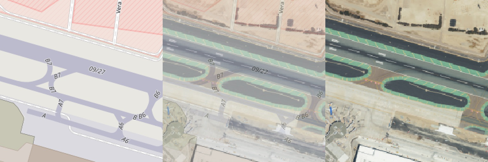

# Geospatial processing

Code: `backend/app/raster.py` (validation, metadata, COG, previews), `backend/app/geospatial.py`
(coordinates, tiling windows, reprojection), `backend/app/tiles.py` (map tiles).

## Coordinate reference systems

| CRS | Used for |
|---|---|
| Source CRS (e.g. EPSG:26911, UTM 11N for NAIP) | Raster storage and processing. Images are never resampled on upload. |
| EPSG:4326 (WGS 84 lon/lat) | Everything stored in PostGIS and returned as GeoJSON |
| EPSG:3857 (Web Mercator) | Map tiles only, produced on the fly by rio-tiler |

Any CRS that PROJ understands is accepted. Rasters without a CRS or geotransform are rejected
rather than guessed. Transformations use PyProj with `always_xy=True` (longitude, latitude order).

## Pixel coordinates

Pixel coordinates follow the GDAL convention: `(col, row) = (0, 0)` is the upper-left corner of
the upper-left pixel, and `(0.5, 0.5)` is its centre. Pixel coordinates are never treated as
geographic coordinates. A point is mapped through the raster's affine geotransform into the
raster's own CRS, and only then reprojected:

```python
lon, lat = pixel_to_geo(transform, raster_crs, col, row)            # → EPSG:4326 by default
col, row = geo_to_pixel(transform, raster_crs, lon, lat)            # inverse
```

Both accept NumPy arrays. They are tested against independent PyProj transforms and for exact
round trips.

## GeoTIFF and Cloud Optimized GeoTIFF

Uploads must be GeoTIFF (TIFF or BigTIFF signature). Each upload is stored twice:

- `images/<id>/original.tif`: unchanged.
- `images/<id>/cog.tif`: a Cloud Optimized GeoTIFF created with GDAL's COG driver: 512 px
  internal tiles, DEFLATE compression with predictor, internal overviews (average resampling) and
  BigTIFF when needed. The source CRS, transform, NoData and band order are kept, and the
  conversion is lossless (tested).

All processing and map tiles read the COG. Its tiling and overviews let GDAL fetch only the bytes it
needs over HTTP range requests.

## Footprints

The image footprint stored in `images.bounds` is the native bounding box densified (32 segments per
side) and reprojected to EPSG:4326. A projected rectangle is not a rectangle in lon/lat, so
transforming only the four corners would cut off curved edges. Footprints that cross the
antimeridian or fall outside valid lon/lat ranges are rejected.

## Processing windows (tiling)

`create_raster_tiles(width, height, tile_size, overlap)` returns overlapping windows covering the
whole raster:

- Tile sizes are configurable (256, 512 and 1024 are tested; detection uses 1024 with 128 px
  overlap).
- Stride = tile size − overlap. The last tile in each row and column is shifted inwards, not
  truncated, so all tiles have the same shape and neighbours overlap by at least `overlap`.
- Rasters smaller than a tile give one window of the raster's own size.
- Windows are read one batch at a time, so memory is bounded by tile and batch size, never by image
  size.
- Windows whose valid (non-NoData) share is below 5 % are skipped.

## Reprojection

`reproject_raster(src, dst, dst_crs)` streams through a GDAL warped VRT into a tiled GeoTIFF, with
bounded memory. It is tested to EPSG:4326 and EPSG:3857 by checking that known locations keep
their values. It is not yet used by the application. It is ready for change detection, which needs
a common grid.

## Map tiles

`GET /api/v1/images/{id}/tiles/{z}/{x}/{y}.png` uses rio-tiler to read the Web Mercator tile from
the COG in MinIO (`s3://` through GDAL `/vsis3/` with explicit credentials, path-style addressing and
range-request merging):

- **Bands:** red/green/blue by colour interpretation, otherwise the first three. Single-band images
  are shown in grey. Extra bands such as NIR are not displayed.
- **Contrast:** 8-bit data is shown as is. Other data types are stretched with a per-image 2–98 %
  percentile range computed once at upload, so all tiles of an image use the same scale and show no
  seams.
- **Transparency:** NoData and masked pixels are transparent.
- **Zoom range:** `minzoom` and `maxzoom` come from the COG's overviews and resolution. MapLibre
  over-zooms beyond `maxzoom`.

### Alignment verification

`tests/test_tiles.py` renders tiles from synthetic rasters made of four coloured quadrants, in
EPSG:4326 and in UTM. For every pixel of the tile it computes the expected quadrant with an
independent implementation of the standard Web Mercator tile formulas, skipping a margin of about
one source pixel around edges. Shifting the raster by 1.5 pixels makes the test fail, which was
checked deliberately.

A visual check against OpenStreetMap: runway 09/27 and taxiways at San Diego line up (OSM on the
left, a 50/50 blend in the middle, NAIP on the right):



## GeoJSON

API output follows RFC 7946: FeatureCollections in EPSG:4326, polygon rings closed and
counter-clockwise (exterior), media type `application/geo+json`. The map's **Eksporter GeoJSON**
button exports exactly the detections currently shown (after confidence and class filters),
without display-only properties.
