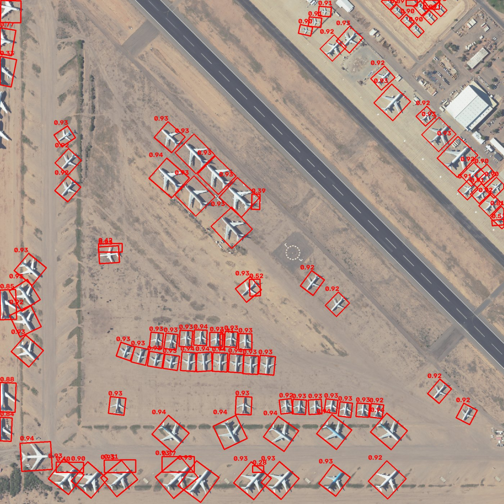

# Machine-learning pipeline

Code: `backend/app/ml/` (`detector.py`, `preprocess.py`, `pipeline.py`, `postprocess.py`,
`metrics.py`, `jobs.py`), and `backend/scripts/evaluate_model.py`.

## Model selection

| | |
|---|---|
| Model | Ultralytics **YOLO26-s OBB** (`yolo26s-obb.pt`, about 9.8 M parameters) |
| Training data | **DOTA v1**: aerial and satellite images with oriented boxes |
| Classes (15) | plane, ship, storage tank, baseball diamond, tennis court, basketball court, ground track field, harbor, bridge, large vehicle, small vehicle, helicopter, roundabout, soccer ball field, swimming pool |
| Output | Oriented bounding boxes (4 corners), class, confidence |
| Licence | AGPL-3.0 (Ultralytics). DOTA is for academic use only. |

**Why this model.** A generic YOLO trained on COCO (ground-level photos) is not suitable for
overhead imagery. DOTA consists of nadir imagery, and oriented boxes fit aircraft and ships parked
at arbitrary angles. YOLO26-s was chosen over the smaller -n variant because, in a quick comparison
on a NAIP airport image, it found the same aircraft plus vehicles that -n missed. The speed
comparison was inconclusive, because the -n run included model warm-up. It runs on CPU. GPU (`cuda:0`) and Apple GPU (`mps`) can be selected
with `DETECTION_DEVICE`.

The weights are downloaded by `make model` from the Ultralytics GitHub release and verified against
a pinned SHA-256 (also checked at load time). The model version stored with each job is that hash.
Ultralytics' usage analytics are disabled.

## Replacing the model

The pipeline depends only on `ObjectDetector`:

```python
class ObjectDetector(ABC):
    def load_model(self) -> None: ...
    def predict(self, images: list[np.ndarray]) -> list[Any]: ...          # RGB uint8 (H, W, 3)
    def postprocess(self, predictions) -> list[list[PixelDetection]]: ...  # 4 corners, class, score
```

`UltralyticsDetector` supports both oriented (OBB) and axis-aligned YOLO models. A remote-sensing
model trained on xView, SpaceNet or a fine-tuned DOTA model, or a non-Ultralytics model, can be
added as another adapter without changing tiling, merging, georeferencing or storage. Models are
loaded once per worker process and reused across jobs.

## Preprocessing

For each processing window:

1. **Band selection.** The bands tagged red/green/blue are used, otherwise the first three.
   Single-band images are repeated to three channels. **Bands beyond RGB (e.g. NAIP's NIR) are
   ignored for detection**, because the model is trained on RGB.
2. **Scaling to 8 bit.** uint8 is used as is. Other types are stretched linearly with the per-image
   2–98 % range computed at upload, the same as for map tiles, so every tile of an image is scaled
   identically.
3. **NoData masking.** NoData pixels are set to black, and windows with less than 5 % valid pixels
   are skipped.
4. **Resizing.** None: tiles are 1024 × 1024, the model's input size. Smaller images are
   letterboxed by Ultralytics.

## Inference and post-processing

```text
windows (1024 px, 128 px overlap)
  → batches of 4 → model → boxes in tile pixels
  → + tile offset → boxes in image pixels (flag boxes touching an inner tile edge)
  → class-wise NMS on oriented polygons
  → clip to image extent → pixel → source CRS → EPSG:4326
  → replace the job's detections in PostGIS
```

**Merging duplicates from overlapping tiles.** This is greedy, per-class NMS using exact polygon
intersection (Shapely). A box is suppressed by a kept box of the same class if their IoU is above
0.5, or if more than 80 % of the smaller box lies inside the other (containment). Boxes that touch
an inner tile edge, and are therefore possibly cut off, rank below complete boxes regardless of
confidence. Objects larger than the overlap keep their partial box instead of disappearing.

**Clipping.** For objects cut by the image border, the model may extrapolate a box beyond the
imagery (up to 14 px seen at NAIP image edges). Stored geometries are clipped to the image extent,
while `pixel_bbox` keeps the model's original corners and sets `clipped_to_image: true`.

**Confidence threshold.** 0.25 at inference, stored with every detection. The UI defaults to
showing detections at 0.5 or above (see the results below), and users can lower it.

## Evaluation

`make evaluate` runs:

1. Ultralytics' own validation of the model on DOTA8 (validation split).
2. **Our full pipeline** (tiling, merging) on the same labelled images, scored by `app/ml/metrics.py`.
3. A speed measurement on a 2048 × 2048 NAIP image.

Our metric implementation matches predictions greedily, in descending confidence, to the unmatched
ground-truth box with the highest IoU at or above the threshold, using exact polygon IoU. It reports
precision, recall and F1 at IoU 0.5, AP with the all-point interpolated precision envelope, mAP@0.5,
and mAP@0.5:0.95 (thresholds 0.50–0.95 in steps of 0.05). It is unit-tested on hand-computed cases.

Results (`data/eval/*.json`, CPU on the development machine, an Apple Silicon MacBook Pro):

| | Precision | Recall | F1 | mAP@0.5 | mAP@0.5:0.95 |
|---|---|---|---|---|---|
| Ultralytics validation | 0.98 | 1.00 | 0.99 | 0.995 | 0.82 |
| Our pipeline + metrics | 0.89 | 1.00 | 0.94 | 1.00 | 0.63 |

| Speed (NAIP, 2048 × 2048, 9 tiles of 1024 px) | |
|---|---|
| Inference per tile | about 170 ms |
| Throughput | about 2.7 megapixels/s |
| Peak resident memory | about 1.8 GB |

**How to read these numbers:**

- **They are not an accuracy estimate.** DOTA8 has 4 validation images with 8 objects, published by
  Ultralytics as a smoke test, and its images come from DOTA v1, which the model was trained on.
  They show that the evaluation tooling works, not how well the model generalises.
- The two rows differ by design. Ultralytics evaluates with confidence 0.001 and an approximate
  rotated IoU (ProbIoU). We evaluate the detections the application actually stores (confidence
  ≥ 0.25) with exact polygon IoU.
- A credible evaluation needs a held-out labelled set from the target imagery, for example
  hand-labelled NAIP tiles. That does not exist yet. `evaluate()` works on any list of
  (predictions, ground truth) pairs, so such a set can be plugged in directly.

### Qualitative results on NAIP airports (visual inspection, not measured)

| Scene | Planes found | Median plane confidence | Planes below 0.5 |
|---|---|---|---|
| Los Angeles (LAX), 2024 | 52 | 0.93 | 4 |
| San Francisco (SFO), 2024 | 48 | 0.92 | 2 |
| Pinal Airpark (aircraft storage), 2025 | 103 | 0.93 | 10 |
| San Diego (SAN), 2024 | 14 | n/a | n/a |



From looking at the results:

- **Good:** nearly all parked aircraft are found, including densely packed rows of stored
  aircraft and both small and wide-body jets. Box orientation follows the aircraft.
- **False positives:** these are mostly low-confidence (0.25–0.6) narrow boxes over a tail, wing or
  jet bridge next to an already detected aircraft, and skewed boxes for aircraft cut by the image
  border. Nearly all false positives scored below 0.5, hence the UI default.
- **Misses:** cars. At 0.6 m a car is about 7 × 3 pixels, and few are detected (with confidence
  around 0.3).
- The 300 m Landsat sample gives 0 detections, which is correct: no object is large enough to be
  visible.

## Known limitations

- Only the 15 DOTA classes. Buildings, roads and terminals are never labelled.
- Performance depends on resolution and on how similar the imagery is to DOTA (DOTA is mostly
  Google Earth imagery). Sentinel-2 (10 m) is not suitable for individual objects.
- Objects larger than the tile overlap (128 px, about 77 m at 0.6 m) may be stored as partial boxes.
- Confidence scores are not calibrated probabilities and must not be presented as proof that a
  detection is correct.
- No fine-tuning or training pipeline yet. The adapter and metrics are in place for it.
